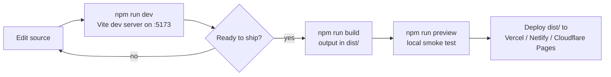
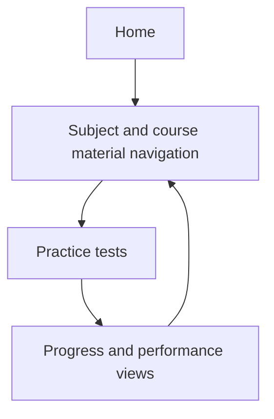

# TS LAWCET Prep

A web-based preparation platform for the Telangana State Law Common Entrance Test. The project provides a structured interface for study material, practice, and progress-oriented exam preparation.

## Features

- Subject and course-material navigation
- Practice-test experience
- Progress and performance views
- Responsive single-page interface

## Tech stack

- React 19
- TypeScript
- React Router
- Vite 5

## Run locally

Requirements: Node.js 18 or newer.

~~~bash
git clone https://github.com/saishivasanjeethpaikarao-jpg/TS-LAWCET.git
cd TS-LAWCET
npm install
npm run dev
~~~

Vite prints the local development URL, normally `http://localhost:5173`.

## Production build

~~~bash
npm run build
npm run preview
~~~

The production files are generated in `dist/` and can be deployed to a static host such as Vercel, Netlify, or Cloudflare Pages.

## Status

Prototype under active development. Verify question content and exam information against official TS LAWCET sources before using it for serious preparation.

## Workflow

## App flow

## Note

The tracked repository currently holds the build config, scripts, and archive zips. If `src/` is missing after cloning, the latest source snapshot is in the bundled zip in the repo root.
